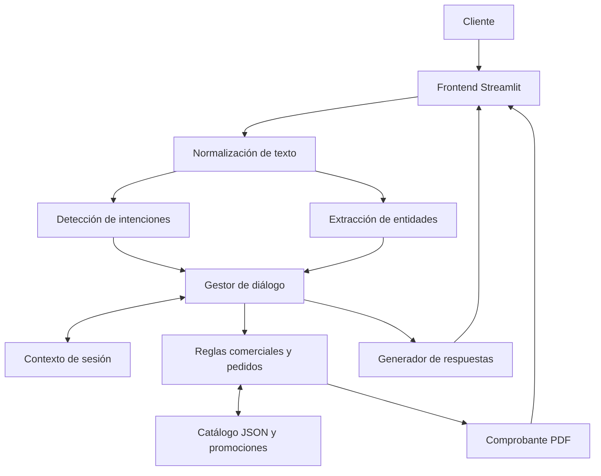

# Arquitectura PizzaBot

El motor es determinista y no realiza inferencia con modelos generativos. Los datos se cargan de JSON en modo lectura. El estado de sesión reside en `st.session_state`. La generación del PDF se realiza en memoria. Las decisiones son auditables en la pestaña didáctica.
